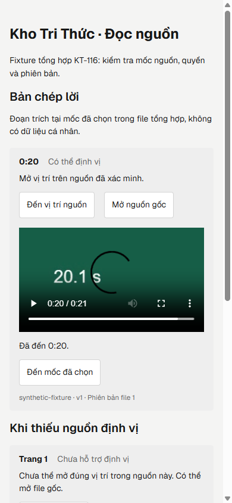
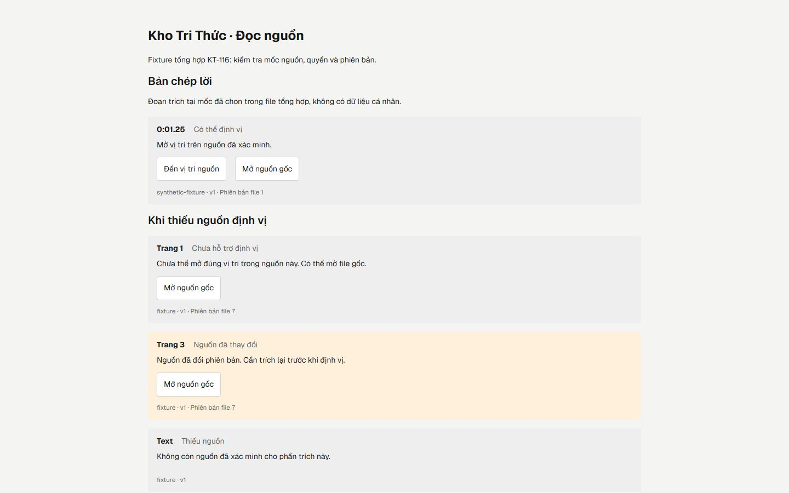

# KT-116 acceptance and integration evidence

This is isolated fixture evidence, not a production Drive/PDF/Android acceptance claim. No original media, user content, OAuth data, provider credentials, database dumps or schema changes are included.

## Results

- Mapping: **30/30** ground-truth PDF/web/audio/video/missing/stale/unsupported cases in `kt116-fixtures.mjs`. Exact asset/source ID, source hash, processor version and actionable page/second are checked. Reversed host viewer ordering is also tested through KnowledgeReading.
- Frontend: `node --test tests/kt116-locators.test.mjs` **10 PASS**; `npm test` **19 PASS**; `npm run build` **PASS** (existing bundle-size warning).
- Backend: `processing.test_read_knowledge` + `processing.test_kt116_locators` **10 PASS**, PostgreSQL at loopback in a separately created/destroyed `test_kt116` database. Ruff check/format **PASS**.
- Real browser: **20 WAV + 20 decoded VP8 WebM seek marks**, targets 0–20 seconds, Chrome **157.0.8103.79**, Windows/headless desktop, tolerance **1 second**, maximum observed `abs(currentTime-target)` **0 seconds**. WAV is PCM signed 16-bit mono 8 kHz, 30 seconds. VP8 is generated 320×180 canvas capture at 10 fps, about 22 seconds; decoded dimensions and distinct source hashes/URLs are asserted.
- Local fixture HTTP: browser cookie-authenticated Range probes return **206** and Content-Range; no-cookie requests return **403**. These small fixtures may be downloaded fully by the media element; the report distinguishes actual 200 media responses from explicit Range probes. This does not measure remote bandwidth or large-file range behavior.
- Responsive inspection: 1440/768/390, **0 FAIL / 3 WARN**. All three native-player screenshots and all six inspector fold/page sheets were opened and reviewed. Warnings concern the development fixture, capped single reading column and empty right side of short text; the production app build was checked separately. No redesign of the shared app shell is claimed.
- **NOT_RUN:** production private Drive byte stream/Range/CORS/auth, private PDF actual page navigation, arbitrary external web heading anchors, physical Android, other browsers/codecs/devices, large remote media, provider token expiry. Native PDF iframe construction is unit-tested only.

Machine results: [browser](kt116-browser-results.json), [inspection](kt116-inspection-results.json).




The initial browser harness reused one URL for two codecs and Chrome retained WAV media bytes; that video result was discarded. The committed harness uses separate asset URLs, hashes, decoded video dimensions and duration assertions. The results above are from that corrected run.

## Existing locator contract

No extractor fields or schema are invented: PDF producers emit one-based `page`; DOCX emits `block`; XLSX emits `sheet`/`row`; UTF-8 emits `{}`; public-web emits `source_id` and fetch provenance; faster-whisper emits `segments[].start/end/text` in seconds and a descriptive `section`. Existing locators have no schema version (legacy v0); optional `schema_version: 1` is accepted by the adapter, unknown versions are rejected. `start_ms`/`start_seconds` are explicit supported adapter inputs, not inferred from words, thumbnails or metadata. Descriptive sections are never treated as timestamps or fabricated DOM anchors.

The read API adds `parts[].source` with state, derived input hash, same-Item source ID/URL, MIME and current Asset content version. Hash mismatch, changed web provenance and refetch failures remain explicit. Foreign-Item/foreign-owner Asset IDs are suppressed. Storage IDs and credentials are not exposed. `current` means the active stored provenance matches the stored verified Asset or active Source record; it does not assert a fresh network read of the remote original. Authoritative Item.note and source records remain unchanged.

## Host integration

`KnowledgeReading` accepts optional `sourceViewers: SourceViewer[]`. Each entry must match the exact asset UUID, source input hash and Asset content version. A host may supply only private same-origin cookie-authenticated `/api/v1/assets/{asset_id}/stream`, `/bytes` or `/content` endpoints, with the matching MIME and explicitly verified Range or PDF-page support. Endpoints must enforce ownership and avoid redirects to token-bearing provider URLs. The UI validates only this capability contract; this PR does not create a provider byte-stream endpoint.

Until such an endpoint is implemented and independently verified, omit `sourceViewers` (the default). Valid citation positions show **NOT_SUPPORTED**, original open goes through the existing authenticated Asset `/open` API, and the returned safe original link is explicitly labeled **without positioning**. Drive /open, thumbnail and preview links cannot enable AVAILABLE. The existing ItemScreen illustration callback still scrolls to the shared media area and ignores its asset argument; G00 may later connect that argument to an exact media row. No changes to ItemScreen, api.ts, package.json, styles.css, shared runner or CURRENT_STATE are included.

Rollback: revert the KT-116 commits; no database or file restoration is needed. G00 owns integration/current-state reporting after review. Do not merge or deploy automatically.

## Reproduce

From `apps/web`:

```text
npm ci --ignore-scripts
node --test tests/kt116-locators.test.mjs
npm test
npm run build
node tests/kt116-browser.test.mjs
```

The optional `KT116_INSPECTOR` environment variable points to the installed design-taste-frontend `scripts/inspect.mjs` for responsive inspection. Set `CHROME_PATH` for a non-default Chrome location. Browser output goes under the ignored repository `tmp/kt116-evidence/`; generated WAV/WebM bytes exist only in memory. The default Windows Chrome path is supported by the standalone harness; no extra browser package is installed.

For backend, provide the existing Django/PostgreSQL test environment and set `settings.DATABASES['default']['TEST']['NAME'] = 'test_kt116'` before `DiscoverRunner.run_tests(['processing.test_read_knowledge', 'processing.test_kt116_locators'])`. Runtime credentials are deliberately not reproduced in this file.

## Visual critique

ROUND 3
Seen in one second: A reading citation with a source position and clear availability.
Idea (one sentence): A citation states exactly what can be opened and preserves its source version.
Live thing: The source position opens a verified player; unsupported citations offer the original file.
Layout words by section: transcript=reading-column / source-states=stacked-citations.
Scores: design 7 · usability 8 · creativity 6 · content 8 → overall 7.2.
Caps applied: none; this is an existing app component rather than a marketing page.
Top three problems (most visible first), each with the screenshot it shows in and the fix:
1. Desktop short fixture text leaves room within the reading column (desktop fold). Keep the established reading width; actual excerpt length determines fullness.
2. Native paused VP8 shows a browser buffering glyph over the selected visible 20.1-second frame (390px native-player screenshot). Target currentTime/decoded dimensions pass; large remote playback remains unmeasured and must be verified with the provider endpoint.
3. Repeated processor/version footers add density on mobile (mobile page sheet). Preserve provenance for the PoC; collapse into a source detail view only after integration research.

The component keeps the existing Geist/type and neutral app tokens, so no direction was drawn or external imagery obtained. Both screenshots contain only generated fixtures. The remaining 7.2 score is reported without rounding up.
